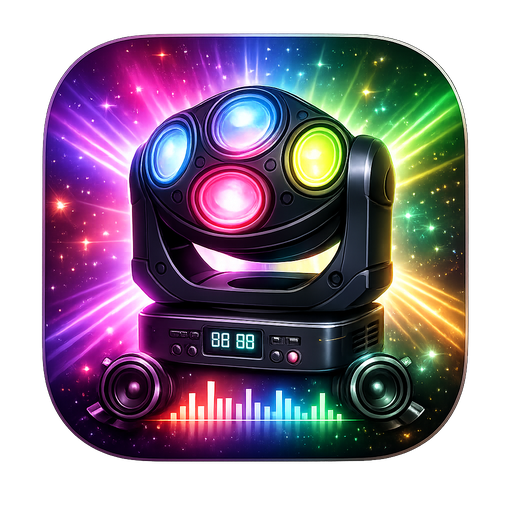
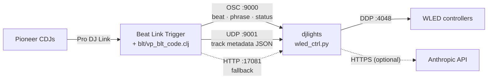

<p align="center">
  
</p>

<h1 align="center">djlights</h1>

<p align="center">
  <strong>Phrase-aware LED lighting for DJs.</strong><br>
  Reads Pioneer CDJs through Beat Link Trigger and drives WLED strips and globes in real time.
  An optional Claude-powered lighting director plans each track's show.
</p>

<p align="center">
  
  
  
  
</p>

---

## Contents

- [What it does](#what-it-does)
- [How it works](#how-it-works)
- [Requirements](#requirements)
- [Quick start](#quick-start)
- [Documentation](#documentation)
- [Project layout](#project-layout)
- [Contributing](#contributing)
- [License](#license)

## What it does

- **Follows the music structure.** rekordbox phrase analysis tells djlights
  whether a track is in its intro, verse, up, chorus, down/bridge or outro, and
  the lights change on those boundaries.
- **Stays on the beat.** Beat Link Trigger sends every beat, the current tempo
  and 3-band energy (bass / mid / treble) from the CDJs.
- **Drives WLED.** It streams pixels over DDP at up to 120 fps to strips,
  snake-wired panels and LED globes. You can define multiple rigs ("setups") and
  switch between them.
- **Has an optional AI director.** On every track load, Claude plans effect,
  palette, brightness, speed and motion for each phrase. After a set, it learns
  rules from how the show went.
- **Is configurable in the app.** Devices, geometry and palettes live in the
  LED CONTROL tab. Ports, FPS, AI models and phrase defaults live in the
  SETTINGS tab.

## How it works



Beat Link Trigger does the Pro DJ Link work: metadata, beat grids, phrase
analysis and waveforms. A small Clojure layer turns all of that into OSC and
UDP messages for the Python app. The app merges them into one snapshot per
player, picks what the lights should do, and renders frames to every WLED
device.

See [docs/architecture.md](docs/architecture.md) for the full picture.

## Requirements

| | |
|---|---|
| **OS** | macOS (it uses CoreBluetooth and App Nap control through pyobjc) |
| **Python** | 3.10 or newer, **with tkinter**: `brew install python@3.12 python-tk@3.12` |
| **Beat Link Trigger** | 8.x, from [Deep-Symmetry/beat-link-trigger](https://github.com/Deep-Symmetry/beat-link-trigger/releases) |
| **Players** | Pro DJ Link CDJs (e.g. CDJ-3000 or CDJ-2000NXS2) on the same network as the Mac |
| **Music** | Tracks analysed in rekordbox **with phrase analysis** |
| **LEDs** | One or more [WLED](https://kno.wled.ge/) controllers on the network |
| **AI** *(optional)* | An [Anthropic API key](https://console.anthropic.com/) |

## Quick start

```bash
git clone https://github.com/ckraan/djlights.git
cd djlights
./install.sh            # or: ./install.sh en5   (pin BLT to the CDJ network interface)
```

1. **Beat Link Trigger:** *File → Open* → `blt/djlights.blt`.
   This file is generated by `install.sh` with the correct paths for your machine.
2. **Start the app:**
   ```bash
   ./run.sh
   ```
3. **Add your LEDs:** in *LED CONTROL*, click **+ ADD DEVICE** and enter each
   WLED controller's IP, LED count and geometry.
4. **Enable the AI** *(optional)*: in *AI CONTROL*, paste your Anthropic API key
   and click **Initialize AI**.

To try it without any CDJs, click **▶ DEMO** in the title bar. It replays a
simulated set from `demo_plan.json`.

A full walkthrough is in [docs/installation.md](docs/installation.md).

## Documentation

| Guide | What's in it |
|---|---|
| [Installation](docs/installation.md) | Step-by-step setup, networking, first run |
| [Configuration](docs/configuration.md) | Devices, geometry, palettes, the SETTINGS tab, config files |
| [Beat Link Trigger integration](docs/beat-link-trigger.md) | How the BLT expressions work and the exact OSC/UDP message protocol |
| [Architecture](docs/architecture.md) | Data flow, render loop, effects, AI director, file-by-file code map |
| [Troubleshooting](docs/troubleshooting.md) | Common problems and how to fix them |

## Project layout

```
djlights/
├── wled_ctrl.py            Main app (CDJ MONITOR · LED CONTROL · AI CONTROL · SETTINGS)
├── blt_client.py           Receives BLT data (OSC / UDP / HTTP / state file)
├── player_state.py         Immutable per-player snapshots
├── effects/                Effects per phrase type (intro, verse, up, chorus, …)
├── *_renderer.py           Vault (2D), globe (3D) and back-strip renderers
├── ai_light_control.py     AI CONTROL tab and show planning
├── light_ai.py             Anthropic API client
├── prompts/                System prompts for the AI director
├── settings.py             settings.json defaults and access
├── settings_tab.py         SETTINGS tab
├── blt/                    Beat Link Trigger show template + Clojure expressions
├── prodj/                  Bundled python-prodj-link (direct Pro DJ Link, legacy path)
├── docs/                   Documentation
├── install.sh / run.sh     Install and start scripts
└── requirements.txt        Pinned Python dependencies
```

## Security

Your Anthropic API key is stored locally in `ai_config.json`. That file is
git-ignored. **Never commit it.** See [SECURITY.md](SECURITY.md).

## Contributing

Issues and pull requests are welcome. See [CONTRIBUTING.md](CONTRIBUTING.md).

## License

Released under the [MIT License](LICENSE).
Bundled third-party code keeps its own license. See
[THIRD_PARTY_NOTICES.md](THIRD_PARTY_NOTICES.md).

djlights is not affiliated with Pioneer DJ, AlphaTheta, Deep Symmetry, WLED or Anthropic.
