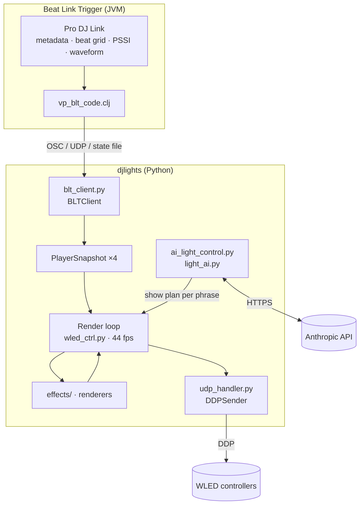

# Architecture

← [Back to README](../README.md)

## Overview

## Data flow, step by step

1. **Track load.** BLT detects a track on player *n*. `vp-dump-meta!` sends a
   `track_meta` packet (phrases, cues, BPM, key, mood) to `BLTClient`.
2. **AI plan** *(when AI is on)*. `AILightControl` sends the track structure to
   Claude, using `prompts/track_plan.md` and any learned rules. The reply is a
   plan with, per phrase: effect, palette, brightness, speed, direction,
   grouping, spacing and density. It is cached per track ID. A plan that was
   later improved (*Improve*) is reused automatically.
3. **Every beat.** BLT sends `/blt/beat`. The snapshot gets the new beat number,
   tempo, bar position, energy and current phrase.
4. **Every frame** (44 fps by default):
   - the render loop picks the *driving* player: the on-air master, scored by
     `_score_snap`
   - **when the phrase changes**: it applies the AI plan entry for that phrase,
     or falls back to the phrase defaults (palette pool, brightness, direction,
     spacing). Then it instantiates the matching effect from `effects/`.
   - the effect renders a frame. It is beat-synced and modulated by the
     bass/mid/treble energy.
   - device-specific renderers add their layer: vault 2D patterns, globe 3D
     patterns, and the back strip (which only reinforces energy).
   - `DDPSender` sends each device its pixels.
5. **Cue jumps and loops** are detected from beat-number jumps. They re-trigger
   the effect without changing the plan.
6. **After the set**, **Learn from Set** sends the session telemetry to the
   smart model (`prompts/learn_from_session.md`). The returned rules
   (brightness and speed floors, style notes) are saved to
   `learned_rules.json` and fed into future plans.

## Threads

| Thread | Owner | Job |
|---|---|---|
| Tk main loop | `DJLightsApp` | UI only |
| Render thread | `DJLightsApp` | Frame timing, effect rendering, DDP send |
| `blt-osc`, UDP, HTTP poller, state-file poller | `BLTClient` | Ingest BLT data |
| AI worker threads | `AILightControl` | API calls (never on the render thread) |
| Feedback server | `web_feedback.py` | Phone rating page |

`system_priority.py` turns off macOS App Nap and raises the process priority, so
the frame timing stays stable when the window is in the background.

## Phrase model

| Kind | Typical role | Default brightness |
|---|---|---|
| `intro` | Set the mood | 35 % |
| `verse` | Groove | 60 % |
| `up` | Build tension | 80 % |
| `chorus` | Peak / drop | 100 % |
| `bridge` | Transition (handled as `down` by the effect engine) | 55 % |
| `down` | Breakdown, release | 45 % |
| `outro` | Fade out | 30 % |

You can change all defaults in the [SETTINGS tab](configuration.md#settings-tab).

## Code map

### Core

| File | Role |
|---|---|
| `wled_ctrl.py` | Main application: UI tabs, render loop, phrase → effect logic, demo player |
| `blt_client.py` | BLT ingest (OSC, UDP, HTTP, state file), metadata cache, health |
| `player_state.py` | `PlayerSnapshot`, `Phrase`, `CuePoint` (immutable dataclasses) |
| `settings.py` / `settings_tab.py` | `settings.json` and the SETTINGS tab |
| `config_manager.py` | Devices, setups and palettes persistence |
| `device_manager.py` | Device list and enable state |
| `palette_manager.py` | Palettes and gradient sampling |
| `geometry.py` | Linear, snake and globe pixel mapping, plus previews |
| `udp_handler.py` | `DDPSender`: DDP packets with jitter tracking |
| `system_priority.py` | App Nap / priority control |

### Rendering

| File | Role |
|---|---|
| `effects/` | `base.py` (base class) and one module per phrase type, plus `advanced.py`, `vault.py`, `choreo_modes.py` |
| `advanced_engine.py` | Persistent-buffer and particle renderer |
| `animation_engine.py` | Standalone animation engine |
| `vault_renderer.py` | Generative patterns on a 5×300 2D canvas |
| `globe_renderer.py` | Sphere patterns for LED globes |
| `cave_strip_renderer.py` | Back strip, gated by energy on up/chorus |
| `choreography_manager.py` | Choreography modes and demo sequencing |

### AI

| File | Role |
|---|---|
| `ai_light_control.py` | AI CONTROL tab, plan cache, improve and learn flows |
| `light_ai.py` | Anthropic client: `decide`, `plan_track`, `improve_plan`, `learn_from_session` |
| `vault_planner.py`, `globe_planner.py` | Plans for the vault and globe renderers |
| `prompts/` | System prompts: `track_plan`, `improve_plan`, `learn_from_session`, `light_ai`, `vault_gen_plan`, `globe_plan` |

### Optional / legacy / tools

| File | Role |
|---|---|
| `mixer_midi.py`, `mixer_midi_tab.py` | Pioneer DJM-A9 MIDI → deck weights (tab not mounted) |
| `web_feedback.py` | Phone feedback page; a "bad" vote re-rolls the current look |
| `prodj/`, `main.py`, `app.py`, `engine.py`, `wled.py`, `wled_engine.py` | Earlier direct Pro DJ Link path without BLT (bundled python-prodj-link) |
| `monitor.py`, `perf_report.py` | Diagnostics |
| `test_ai.py`, `test_ai_extended.py` | Manual AI test scripts (`--key` or env var) |
| `ble_test.py`, `cdjtab_waveform_rewrite.py`, `vault_preview_tab.py` | Experiments |
